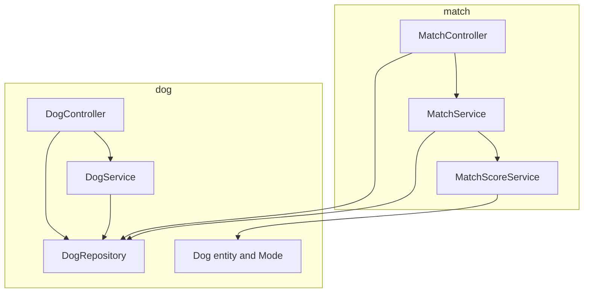
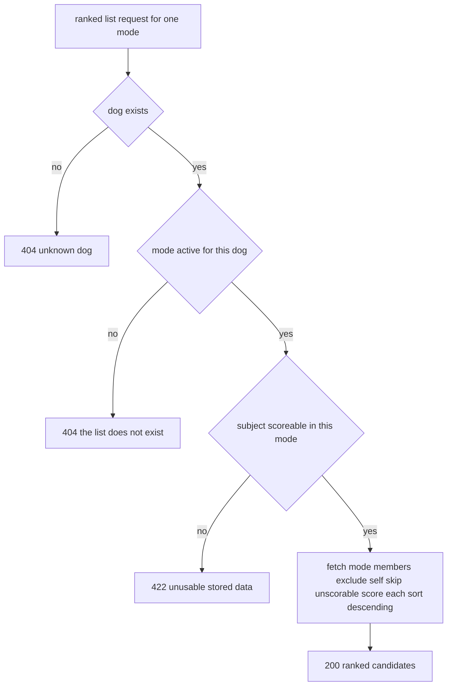

# Design Document — F-03: Play and Mating Modes

## Overview

**Purpose**: This feature gives every dog profile an active set of modes —
**play**, **mating**, or both — and makes matching mode-aware: each mode gets its
own candidate list, ordered by its own compatibility score, and mating mode is
only available to profiles that carry the mating-specific details.

**Users**: private dog owners (via the REST API) looking for a playmate, a
mating partner, or both; the API clients that serve them.

**Impact**: replaces the mode-agnostic match endpoints with mode-named ones,
removes the mating bias from play rankings, introduces a `Mode` concept to the
`dog` package, and adds a `DogService` (the first domain service in `dog/`).
Today's single score becomes the mating score; the play score drops the two
mating-only criteria (same breed, opposite genders).

### Goals

- Every requirement in `requirements.md` (1.1–4.3) is implemented against the
  existing stack, with no new runtime dependency.
- Play rankings stop being contaminated by mating-only criteria.
- The two known controller debts (`MatchController` composition in controller,
  `MatchResponse` meaning two things) are retired in the seam this feature
  rewrites.

### Non-Goals

- Final scoring criteria and weights (F-04); this design assigns interim
  criteria only, inside a per-mode seam.
- Input rules and verification of pedigree, neutering status, health status
  (F-02); this design carries their nullable passthrough storage, a bridging
  decision confirmed with the product owner and recorded in
  `requirements.md` and `research.md`.
- Location radius, search filters, swipes, matches, chat, metrics, and score
  visibility (F-05, F-06, F-07, F-08, F-09, F-11). Scores stay exposed in API
  responses exactly as today.

## Boundary Commitments

### This Spec Owns

- The `Mode` concept (`PLAY`, `MATING`), its per-dog storage, and the rules that
  a dog always has at least one active mode and that modes are replaceable.
- The mode surface of the dog profile: declaring modes at creation, changing
  them later, returning them with the profile.
- The mating-mode activation gate: presence check over pedigree, neutering
  status, health status, including the bridging nullable storage and transport
  of those three fields.
- Mode-specific candidate lists: membership (both dogs active in the mode),
  self-exclusion, tolerance of unscorable candidates, rejection of unscorable
  subjects, and ordering by the mode's score.
- The per-mode scoring seam (`score(mode, a, b)`, `canScore(mode, dog)`) with
  interim criteria assignments.

### Out of Boundary

- Semantic input rules and verification for pedigree, neutering status, health
  status (F-02). Presence of a non-null value is the only rule here.
- Final criteria and weights for the play and mating scores (F-04). The
  criteria tables below are interim assignments, marked for replacement.
- Anything about likes, matches, notifications, chat, radius, filters, or
  metrics (F-05–F-11), including the effect of switching a mode off on past
  likes or matches: none exist.
- Multiple dogs per owner, owner accounts, authentication (F-01, F-02, v2).

### Allowed Dependencies

- `dog/` model and `DogRepository` — from `match/` only. The existing
  dependency direction (`match` reads from `dog`, `dog` knows nothing of
  `match`) is preserved and must not be violated.
- The existing stack only: Kotlin 2.3, Spring Boot 4.1 (web, data-jpa,
  validation, liquibase), jackson-module-kotlin, Liquibase, PostgreSQL 18.
  Mockito (test scope, already on the classpath) is used for repository seams;
  no new dependency is added.

### Revalidation Triggers

- F-02 lands richer semantics for the mating fields — the gate must stay
  presence-only by explicit decision, and F-02 must adopt these columns.
- F-04 redefines criteria — only the internals of the per-mode scorers and the
  per-mode maxima may change; the seam signatures stay.
- F-05 adds radius to list composition — `MatchService.ranked` membership
  filtering is the integration point.
- A third mode is ever added — endpoints are literal per mode; every endpoint,
  DTO, and the gate would need revisiting.

## Architecture

### Existing Architecture Analysis

One Spring Boot service, two vertical slices. `dog/` owns the profile
(entity, repository, controller, DTOs) with no service because it had no domain
rules; `match/` owns a stateless scorer and a controller that composes lists
itself. Matches are computed on request and never stored. Schema authority is
Liquibase; Hibernate validates only. Known debts this design retires:
in-controller list composition and the dual meaning of `MatchResponse`
(`structure.md`, Known Inconsistencies).

### Architecture Pattern & Boundary Map



- **Selected pattern**: the existing package-per-concept vertical slice,
  extended. No new layers, no strategy or registry abstraction for modes.
- **Domain boundaries**: mode rules live in `dog/` (`DogService`, `Mode`);
  scoring and list composition live in `match/`. Controllers translate absence
  to 404 and unusable data to 422; domain rules live in services only.
- **Dependency direction**: `match/` → `dog/`, never the reverse.
- **New components**: `DogService` (first domain rules in `dog/`), `MatchService`
  (list composition out of the controller). Both exist because rules move out
  of controllers per `AGENTS.md`.

### Technology Stack

| Layer | Choice / Version | Role in Feature | Notes |
|-------|------------------|-----------------|-------|
| Backend | Kotlin 2.3 on Spring Boot 4.1 | services, controllers, DTOs | unchanged stack |
| Persistence | JPA (Hibernate 7) + PostgreSQL 18 | `Mode` set, mating detail columns | `@ElementCollection` mirroring `preferences` |
| Schema | Liquibase, plain SQL | changeset file `005` | append-only, registered in the YAML index |
| Test | JUnit 5, AssertJ, Mockito | service units, `@WebMvcTest` slices | Mockito already on classpath, first use |

## File Structure Plan

### Directory Structure

```
src/main/kotlin/com/ai4dev/tinder4dogs/
├── dog/
│   ├── Dog.kt                  # Dog entity: + modes set, + 3 nullable mating detail fields; Mode enum
│   ├── DogRepository.kt        # + findByModesContaining(mode)
│   ├── DogService.kt          # NEW: mode rules — at least one mode, mating gate, missingMatingDetails
│   └── DogController.kt       # DogRequest/DogResponse extended; ModesRequest; PUT /{id}/modes; gate translation
└── match/
    ├── MatchScoreService.kt    # per-mode scoring: score(mode, a, b), canScore(mode, dog), interim criteria
    ├── MatchService.kt         # NEW: ScoredCandidate; ranked list composition; pairwise
    └── MatchController.kt      # mode-named endpoints; RankedCandidateResponse; PairwiseScoreResponse

src/main/resources/db/changelog/
├── db.changelog-master.yaml    # appended include for 005
└── changes/005-dog-modes-and-mating-details.sql   # NEW: dog_mode table, PLAY seed, mating columns

src/test/kotlin/com/ai4dev/tinder4dogs/
├── dog/DogServiceTest.kt       # NEW: mode rules and gate
├── dog/DogControllerTest.kt    # NEW: @WebMvcTest — status codes and payloads
├── match/MatchScoreServiceTest.kt  # rewritten per-mode
├── match/MatchServiceTest.kt   # NEW: composition
└── match/MatchControllerTest.kt   # NEW: @WebMvcTest — 404 and 422 behaviors
```

### Modified Files

- `dog/Dog.kt` — add `Mode` enum (beside `Gender`), `modes: MutableSet<Mode>`
  mirroring `preferences`, and `pedigree: String?`, `neutered: Boolean?`,
  `healthStatus: String?`.
- `dog/DogRepository.kt` — add `findByModesContaining(mode: Mode): List<Dog>`.
- `dog/DogController.kt` — `DogRequest` gains `modes` (validated non-empty) and
  the three mating fields; `DogResponse` echoes them; new `ModesRequest` and
  `PUT /api/dogs/{id}/modes`; creation routes through `DogService`.
- `match/MatchScoreService.kt` — signature becomes mode-aware; criteria split
  per mode; per-mode derived maxima.
- `match/MatchController.kt` — endpoints replaced (below); DTOs split.
- `db/changelog/db.changelog-master.yaml` — append one include; never edit
  existing entries.

## System Flows

### Ranked list request — `GET /api/matches/{dogId}/{play|mating}`



The pairwise flow is the same shape with two dogs: unknown dog → 404, the mode
not active on **either** dog → 404, either dog unscorable → 422. Mode-change
validation (`POST /api/dogs`, `PUT /api/dogs/{id}/modes`) is a single gate: bean
validation rejects an empty mode set (400); the mating gate rejects activation
with a 422 naming the missing fields.

## Requirements Traceability

| Requirement | Summary | Components | Interfaces | Flows |
|-------------|---------|------------|------------|-------|
| 1.1 | modes recorded at creation | Dog + Mode, DogService, DogController | POST /api/dogs | — |
| 1.2 | creation without a mode rejected | DogRequest (`@NotEmpty`), DogService require | POST /api/dogs | — |
| 1.3 | modes returned with the profile | DogResponse | GET /api/dogs, GET /api/dogs/{id}, PUT /{id}/modes | — |
| 1.4 | mode changes apply to later requests | DogService.replaceModes; stateless composition | PUT /api/dogs/{id}/modes | Ranked list |
| 1.5 | change to zero modes rejected | ModesRequest (`@NotEmpty`), DogService require | PUT /api/dogs/{id}/modes | — |
| 2.1 | play list, play members only, ordered | MatchService.ranked, DogRepository.findByModesContaining, MatchScoreService | GET /api/matches/{dogId}/play | Ranked list |
| 2.2 | mating list, mating members only | same as 2.1 with MATING | GET /api/matches/{dogId}/mating | Ranked list |
| 2.3 | never a candidate for itself | MatchService filter | list endpoints | Ranked list |
| 2.4 | inactive-mode list does not exist | MatchController 404 translation | list endpoints | Ranked list |
| 2.5 | unscorable candidate skipped | MatchService canScore filter | list endpoints | Ranked list |
| 2.6 | unscorable subject rejected | MatchController 422 via canScore, MatchService require | list endpoints | Ranked list |
| 3.1 | play score from play criteria only | MatchScoreService play criteria | pairwise play, list ordering | — |
| 3.2 | mating score from mating criteria only | MatchScoreService mating criteria | pairwise mating, list ordering | — |
| 3.3 | two separate scores per shared pair | score(mode) dispatch | pairwise endpoints | — |
| 3.4 | score for a non-active mode does not exist | MatchController 404 translation | pairwise endpoints | Pairwise |
| 4.1 | gate rejection names what is missing | DogService.missingMatingDetails + require, DogController 422 | POST /api/dogs, PUT /{id}/modes | Gate |
| 4.2 | gate accepts a complete profile | DogService gate pass | POST /api/dogs, PUT /{id}/modes | — |
| 4.3 | play-only needs no mating details | gate applies only when MATING is requested | POST /api/dogs | — |

## Components and Interfaces

| Component | Domain / Layer | Intent | Req Coverage | Key Dependencies | Contracts |
|-----------|----------------|--------|--------------|------------------|-----------|
| Dog and Mode | dog / entity | store modes and mating detail passthrough | 1.1, 1.3 | — | State |
| DogRepository | dog / persistence | mode membership query | 2.1, 2.2 | Dog (P0) | Service |
| DogService | dog / domain rules | mode lifecycle rules, mating gate | 1.1, 1.2, 1.4, 1.5, 4.1–4.3 | DogRepository (P0) | Service |
| DogController | dog / HTTP | profile and modes surface | 1.1–1.5, 4.1–4.3 | DogService, DogRepository (P0) | API |
| MatchScoreService | match / domain rules | per-mode scoring | 3.1–3.3, 2.5, 2.6 | Dog (P0) | Service |
| MatchService | match / domain rules | list composition, pairwise | 2.1–2.3, 2.5, 2.6, 3.3 | DogRepository, MatchScoreService (P0) | Service |
| MatchController | match / HTTP | mode-named match endpoints | 2.1–2.6, 3.1–3.4 | MatchService, DogRepository, MatchScoreService (P0) | API |
| 005 migration | db / schema | modes table, seed, mating columns | all persisted state | Liquibase (P0) | Schema |

### dog/ — Domain and Persistence

#### Dog and Mode

| Field | Detail |
|-------|--------|
| Intent | persistence shape for a dog and its active modes |
| Requirements | 1.1, 1.3 |

`Mode` is an enum (`PLAY`, `MATING`) beside `Gender` in `Dog.kt`, persisted as
a string. New entity fields, all with Kotlin defaults for the JPA no-arg
constructor:

```kotlin
@ElementCollection(fetch = FetchType.EAGER)
@CollectionTable(name = "dog_mode", joinColumns = [JoinColumn(name = "dog_id")])
@Enumerated(EnumType.STRING)
@Column(name = "mode", nullable = false)
var modes: MutableSet<Mode> = mutableSetOf()

@Column(nullable = true) var pedigree: String? = null
@Column(nullable = true) var neutered: Boolean? = null
@Column(nullable = true) var healthStatus: String? = null
```

The entity carries no rules; "at least one mode" is a service invariant, not a
column constraint (consistent with `age`, which deliberately carries none).

#### DogRepository

One derived query method; no SQL in services:

```kotlin
interface DogRepository : JpaRepository<Dog, Long> {
    fun findByModesContaining(mode: Mode): List<Dog>
}
```

**Implementation Notes**
- If `Containing` does not resolve on the `@ElementCollection` set, fall back to
  `@Query("select d from Dog d where :mode member of d.modes")`; same name, no
  caller changes.

#### DogService

| Field | Detail |
|-------|--------|
| Intent | the mode rules: always at least one mode, replaceable, mating gate |
| Requirements | 1.1, 1.2, 1.4, 1.5, 4.1, 4.2, 4.3 |

```kotlin
class DogService(private val dogs: DogRepository) {
    fun create(dog: Dog): Dog
    fun replaceModes(dog: Dog, modes: Set<Mode>): Dog
    fun missingMatingDetails(dog: Dog): Set<String>
}
```

- `create` — preconditions: `dog.modes` non-empty; if `MATING` is present,
  `missingMatingDetails(dog)` is empty. Postcondition: persisted dog.
- `replaceModes` — preconditions: `modes` non-empty; if `MATING` is present in
  the new set, `missingMatingDetails(dog)` is empty. Postcondition: the dog's
  modes equal the requested set. Replacing with the current set is idempotent.
- `missingMatingDetails` — total companion predicate (the `canScore` pattern):
  returns the subset of `{"pedigree", "neutered", "healthStatus"}` — the API
  field names — that is null. Never throws.

**Implementation Notes**
- Rules are `require` at the top of `create`/`replaceModes` (defense in depth);
  controllers pre-check via `missingMatingDetails` so the 422 can name what is
  missing, exactly as `MatchController` pre-checks `canScore`.
- Mating details are only set at creation (the profile is create/read plus this
  mode update); an existing dog gains mating mode only if it was created with
  details. Full profile editing belongs to F-02.

### dog/ — HTTP

#### DogController

| Method | Endpoint | Request | Response | Errors |
|--------|----------|---------|----------|--------|
| GET | /api/dogs | — | List<DogResponse> | — |
| GET | /api/dogs/{id} | — | DogResponse | 404 |
| POST | /api/dogs | DogRequest | DogResponse | 400, 422 |
| PUT | /api/dogs/{id}/modes | ModesRequest | DogResponse | 400, 404, 422 |

DTOs (in `DogController.kt`, per convention):

```kotlin
data class DogRequest(
    @field:NotBlank val name: String,
    @field:NotBlank val breed: String,
    val gender: Gender,
    @field:Min(0) val age: Int,
    val preferences: Set<String> = emptySet(),
    @field:NotEmpty(message = "at least one mode is required: PLAY, MATING, or both")
    val modes: Set<Mode>,
    val pedigree: String? = null,
    val neutered: Boolean? = null,
    val healthStatus: String? = null,
)

data class ModesRequest(
    @field:NotEmpty(message = "at least one mode must stay active")
    val modes: Set<Mode>,
)

data class DogResponse(
    val id: Long, val name: String, val breed: String, val gender: Gender,
    val age: Int, val preferences: Set<String>, val modes: Set<Mode>,
    val pedigree: String?, val neutered: Boolean?, val healthStatus: String?,
)
```

**Implementation Notes**
- `create`: build the entity in the handler (existing convention), then, when
  `MATING` is requested and `missingMatingDetails` is non-empty, return
  422 with a body naming the missing fields; otherwise `201` with the saved
  profile. Creation saves through `DogService`.
- `PUT /{id}/modes`: 404 when the dog is unknown; 422 (naming missing fields)
  when `MATING` is requested without details; 200 with the updated profile
  otherwise. The handler loads the dog from `DogRepository` for the 404
  translation, then delegates to `DogService.replaceModes`.
- Invalid mode names in JSON fail enum binding with 400 (existing Jackson
  behavior for `Gender`).

### match/ — Domain

#### MatchScoreService

| Field | Detail |
|-------|--------|
| Intent | compatibility score for a pair of dogs, per mode |
| Requirements | 3.1, 3.2, 3.3; supports 2.5, 2.6 |

```kotlin
class MatchScoreService {
    fun score(mode: Mode, a: Dog, b: Dog): Double
    fun canScore(mode: Mode, dog: Dog): Boolean
}
```

Interim criteria (weights unchanged from today; **marked for replacement by
F-04** — revalidation trigger):

| Criterion | Play points | Mating points |
|-----------|-------------|---------------|
| age closeness (linear decay, zero at 10 years) | up to 20.0 | up to 20.0 |
| same breed | — | 25.0 |
| opposite genders | — | 20.0 |
| shared preferences (exact string) | 5.0 each, at most 15.0 | 5.0 each, at most 15.0 |
| derived maximum | 35.0 | 80.0 |

**Implementation Notes**
- Each mode has its own maximum, derived from its own weights (the existing
  "never hard-code the denominator" rule), and its own points function; the
  result stays in `[0.0, 1.0]`.
- `canScore(mode, dog)` is `dog.age >= 0` for both modes today; the mode
  parameter exists because F-04's criteria will make scorability mode-specific.
- `require` (negative age) stays at the top of `score`, per mode.

#### MatchService

| Field | Detail |
|-------|--------|
| Intent | mode-aware composition: ranked lists and pairwise scores |
| Requirements | 2.1, 2.2, 2.3, 2.5, 2.6, 3.3 |

```kotlin
class MatchService(
    private val dogs: DogRepository,
    private val scores: MatchScoreService,
) {
    fun ranked(subject: Dog, mode: Mode): List<ScoredCandidate>
    fun between(a: Dog, b: Dog, mode: Mode): Double
}

data class ScoredCandidate(val dog: Dog, val score: Double)
```

- `ranked` — precondition: `canScore(mode, subject)`. Fetches
  `findByModesContaining(mode)`, excludes the subject itself, drops candidates
  that fail `canScore(mode, …)`, scores each, sorts descending (stable order on
  ties, as today).
- `between` — preconditions: `canScore(mode, a)` and `canScore(mode, b)`.
  Returns `scores.score(mode, a, b)`.

**Implementation Notes**
- This is the list-composition logic moved out of `MatchController` — the
  known debt retired. Controllers translate, this service composes.

### match/ — HTTP

#### MatchController

| Method | Endpoint | Request | Response | Errors |
|--------|----------|---------|----------|--------|
| GET | /api/matches/{dogId}/play | — | List<RankedCandidateResponse> | 404, 422 |
| GET | /api/matches/{dogId}/mating | — | List<RankedCandidateResponse> | 404, 422 |
| GET | /api/matches/{dogId}/{otherDogId}/play | — | PairwiseScoreResponse | 404, 422 |
| GET | /api/matches/{dogId}/{otherDogId}/mating | — | PairwiseScoreResponse | 404, 422 |

Removed: `GET /api/matches/{id}` and `GET /api/matches/{aId}/{bId}` — with
modes, a mode-agnostic match has no defined meaning. Breaking change, no
external callers known; recorded in `research.md`.

DTOs replace `MatchResponse` (the dual-meaning debt):

```kotlin
data class RankedCandidateResponse(val dogId: Long, val name: String, val score: Double)
data class PairwiseScoreResponse(val score: Double)
```

**Implementation Notes**
- Status translation, in order: unknown dog → 404; mode not active (subject
  for lists; **either** dog for pairwise) → 404, because that list or score
  does not exist; subject unscorable in the mode → 422 (bodiless, as today).
- Mode-active checks and `canScore` pre-checks happen in the handler (the
  existing `canScore`-before-`score` pattern), then `MatchService` composes.

## Data Models

### Domain Model

The `Dog` aggregate gains a mode set and three nullable self-declared mating
details. Invariants (service-enforced): at least one active mode; mating mode
implies all three mating details present. `Mode` is a value with exactly two
members today.

### Physical Data Model

New migration file `005-dog-modes-and-mating-details.sql`, three changesets,
registered by appending one include to `db.changelog-master.yaml` (never edit
existing entries):

| Changeset | SQL | Rollback |
|-----------|-----|----------|
| `005-create-dog-mode` | `dog_mode (dog_id BIGINT NOT NULL, mode VARCHAR(10) NOT NULL, PK (dog_id, mode), FK dog_mode → dog ON DELETE CASCADE)` mirroring `dog_preference` | `DROP TABLE dog_mode` |
| `006-seed-play-mode` | `INSERT INTO dog_mode (dog_id, mode) SELECT id, 'PLAY' FROM dog` — every existing dog becomes play-only | `DELETE FROM dog_mode WHERE mode = 'PLAY'` |
| `007-add-mating-details` | `ALTER TABLE dog ADD COLUMN pedigree VARCHAR(200), ADD COLUMN neutered BOOLEAN, ADD COLUMN health_status VARCHAR(200)` (all nullable) | drop the three columns |

### Data Contracts & Integration

JSON payloads follow the DTOs above; `Mode` serializes by name (`"PLAY"`,
`"MATING"`). No events, no cross-service data management — single service,
matches computed on request and never stored.

## Error Handling

| Status | Cause | Body |
|--------|-------|------|
| 400 | empty `modes` in `DogRequest`/`ModesRequest` (bean validation); unknown mode name (enum binding) | validation error, message names the field |
| 404 | unknown dog id; list for a mode the dog does not have active; pairwise score for a mode not active on either dog | bodiless, as today |
| 422 | mating gate: `MATING` requested while mating details are missing | message naming the missing fields, e.g. `mating mode requires pedigree, neutered and health status; missing: pedigree, neutered` |
| 422 | subject (list) or either dog (pairwise) unscorable in the requested mode | bodiless, as today |

No `@ControllerAdvice`; controllers return `ResponseEntity` for non-200
outcomes. Services' `require` remains defense in depth, as today.

## Testing Strategy

Unit tests (no Spring context; services instantiated directly; Mockito mocks
the repository seam; assertions relational, each able to fail):

- `MatchScoreServiceTest` (rewritten per mode):
  - the play score is unchanged by breed or gender — same-breed vs other-breed
    and opposite vs same gender score equally in `PLAY` (3.1)
  - the mating score still rewards same breed and opposite gender (3.2)
  - play and mating scores differ for a pair that differs in breed or gender (3.3)
  - per-mode scores stay within `[0.0, 1.0]`; negative age rejected per mode
- `DogServiceTest` (new):
  - creation and mode replacement reject an empty mode set (1.2, 1.5)
  - mating activation at creation and via replacement is rejected and the
    error names exactly the missing fields (4.1)
  - mating activation succeeds when all three details are present (4.2)
  - a play-only dog needs no mating details (4.3)
  - `missingMatingDetails` returns exactly the null subset
- `MatchServiceTest` (new):
  - the play list excludes mating-only dogs and vice versa (2.1, 2.2)
  - a dog is never its own candidate (2.3)
  - an unscorable candidate is skipped while the list still returns (2.5)
  - an unscorable subject is rejected (2.6)
  - results are ordered by score, descending

HTTP slices (`@WebMvcTest` + `@MockitoBean`; first use, endorsed by
`structure.md` for the untested HTTP surface):

- `DogControllerTest`: create returns 201 with modes echoed (1.1, 1.3); create
  with `MATING` and missing details returns 422 naming them (4.1); empty modes
  returns 400 (1.2); `PUT /{id}/modes` returns 200 with the new modes and 404
  for an unknown dog (1.4)
- `MatchControllerTest`: a play list for a play-active dog returns 200 (2.1);
  the mating list of a play-only dog returns 404 (2.4); a pairwise score for a
  mode not active on either dog returns 404 (3.4); an unscorable subject
  returns 422 (2.6)

## Migration Strategy

Single Liquibase file, appended to the index; startup validates the schema
(`ddl-auto: validate`). Steps: create `dog_mode`, seed `PLAY` for all existing
dogs, add the three nullable columns. Each changeset carries an explicit
`--rollback`. No phase gating is required; the seed changeset makes the
"at least one mode" invariant true for every pre-existing row the moment the
schema changes, so old and new code see complete data. The deliberately bad
`Nonna` row is untouched — it stays unscoreable and is skipped in lists of every
mode, exactly as today.
